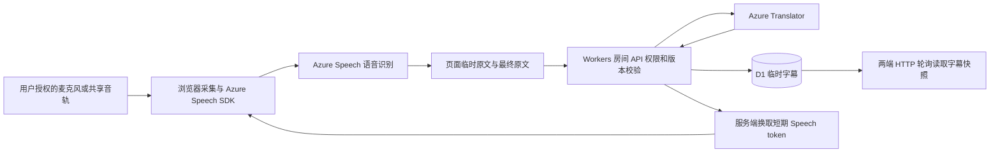

# Kotoba V0.7 项目完整交接

核对日期：2026 年 10 月 27 日。本文面向接手开发的新聊天和维护者，以 V0.7 源码为准，说明现有功能、技术链路、操作流程、验证结果和未完成事项。新聊天可先阅读配套的 [启动提示词](Kotoba-New-Chat-Prompt.md)。

Kotoba（语间，代码目录名 Talkbridge）是免登录、依赖云端语音识别与翻译的网页字幕工具。当前支持中文、日语、韩语、英语，提供双手机面对面、远程双人、单手机面对面、视频会议字幕四种使用方式。它不是 Costudy，也不是已打包的安卓原生应用。

## 1 当前版本与项目位置

| 项目 | 当前值 |
| --- | --- |
| GitHub 仓库 | [SHI-0721/AI_Project_2026_2](https://github.com/SHI-0721/AI_Project_2026_2) |
| 交付目标分支 | `main`；V0.7 来源分支为 `codex/kotoba-v07` |
| 应用版本 | `talkbridge/package.json` 的 `0.7.0` |
| V0.7 应用 GitHub 提交 | `803d336bd170322038e80e8b4e9c07a73e2fe9b1`；交接文档为后续独立提交 |
| 线上网站 | [Kotoba 免登录网站](https://talkbridge-cn-ja-20261024.artfulzebra9.chatgpt.site) |
| 本地外层仓库 | `C:\Users\ASUS\.codex\worktrees\ae50\AI_Project_2026_0` |
| 本地应用目录 | `C:\Users\ASUS\.codex\worktrees\ae50\AI_Project_2026_0\talkbridge` |
| Sites 项目 ID | `appgprj_6adc6121989881918dd687ad3da04ca1` |
| Sites 已保存版本 | 第 9 版，对应产品 V0.7；两套版本编号含义不同 |
| Sites 源码提交 | `a4b4a0b22e489da7f3a8264f8df2826e44fd356b` |
| Sites 版本 ID | `appgprj_6adc6121989881918dd687ad3da04ca1~appgver_323ea47b078c819196e1fab5adf0ff47` |
| 最近成功部署 | `appgdep_6ade424a62888191935a522309d72d54` |

本次实时读取 Sites，状态为 `active`，访问配置为 `public`，上述部署为 `succeeded`。GitHub 应用目录与 Sites 源码的 Git tree 均为 `7c48e275601400b55d7869a27f63d01a23a26041`，内容一致。本次只增加外层交接文档，不改变已发布应用。

本机存在两层独立 Git 仓库：外层推送 GitHub，内层 `talkbridge/.git` 由 Sites 源码工作流管理。外层将 `talkbridge` 作为普通源文件跟踪，并非 submodule。新克隆的 GitHub 仓库通常只有外层 `.git`，不要假定每台机器都保留内层仓库。

另一个工作目录 `D:\program file\Programming\AI_Project_2026_0` 正检出本地 `main`。远程 main 合并不等于该目录的工作树自动更新；后续先检查它的未提交修改，再决定如何同步。不要为了切换分支强制重置或删除其他工作树。

## 2 用户需求与版本演进

用户最初需要两部安卓手机显示中日实时翻译字幕，免去持续按住说话按钮；之后增加免登录、直接加入、刷新恢复、韩语、手动纠错、延迟诊断、单手机分屏和英语会议字幕。V0.7 解决“异地两台设备加入同一房间，但来宾没有收音”的模式差异。

| 阶段 | 已进入当前代码的能力 |
| --- | --- |
| V0.1 | 中日字幕、房间、演示模式及 Azure 接入基础 |
| V0.2 | 直接加入、恢复及重连入口；托管访问改为公开，取消 GPT 登录 |
| V0.3 | 韩语、最终原文手动纠错及重新翻译 |
| V0.4 | 本地原文草稿、同句译文复用、停更提示、耗时诊断 |
| V0.5 起的单手机增量 | 匿名说话人 A/B、上下分屏、上半屏旋转、归属纠错 |
| V0.7 前的会议增量 | 英语、电脑／标签页音频与麦克风切换、会议字幕页面、本机英文朗读 |
| V0.7 | 远程双方独立麦克风、独立启停与重连、字幕同步、角色和收音世代隔离 |

用户还讨论并授权过 Speech 升级 S0、Translator 保持 F0、使用学生额度和全站每月 8 小时控制。**这些不能据此记作已经实施：当前代码没有月度额度控制，本次也未核实云端 SKU 已升级。** 详见费用章节。

已有 DocZoom 静态分析提供过流式识别、临时／最终字幕、分句和同步队列等设计线索；这不等于运行时验证。当前 Kotoba 的房间同步使用 HTTP 轮询，不是 DocZoom 的 SignalR，也没有接入其桌面程序或复制其完整实现。

## 3 四种使用方式

| 入口与模式 | 谁提供声音 | 如何区分发言 | 页面与主要限制 |
| --- | --- | --- | --- |
| `/` 双手机面对面，`paired` | 只有房主手机采集现场两个人的声音；来宾不采音，接收同步字幕 | 在所选两种语言之间连续识别，按语言归属 | 两端都是上方对方、下方自己；双方语言必须不同 |
| `/` 远程双人，`remote` | 两端各自明确点击开麦，使用自己的麦克风 | 按房主／来宾设备角色，固定识别本人语言 | 独立开始、暂停、重连；必须是两种不同语言；仅真实模式 |
| `/solo` 单手机面对面，`solo` | 一部联网手机采集双方 | Azure 匿名说话人标签映射为 A/B | 上半屏默认旋转 180°，双方可选相同语言；不能邀请第二端 |
| `/meeting` 会议字幕 | 每次只选麦克风或用户授权的共享音轨 | 固定源语言，不做人声分离 | 源／目标语言与交换、快捷模式、原译文历史、复制、本机英文播放 |

四种是产品体验，数据库 `deviceMode` 只有 `paired / remote / solo`；会议页复用私有 `solo` 房间，并没有第四种 `meeting` 数据库类型。`mode: demo / live` 则表示演示或真实服务，与设备模式不同。

### 3.1 远程双人的正确操作

1. 房主选择“远程双人”和自己实际说的语言，创建房间。
2. 朋友通过邀请链接、二维码或八位房间码加入，选择自己的语言；不要求 GPT 登录和房主二次确认。
3. 双方各自点一次开始并允许本机麦克风，之后连续说话即可。
4. 每端显示对方译文和自己的原文；本人暂停、刷新或切后台只停止本人的收音。
5. 返回页面或恢复网络后主动重新开始。离开或结束房间会停止本轮双方收音并清理字幕。

远程模式同步文字，不传输两端通话声音。若用户还需要听见对方，须另外使用通话软件；麦克风若收到对方外放声仍可能误识别，耳机可减少这类串音。页面里的“房间运行中”不等于本机正在收音，要看本人的收音状态。

### 3.2 单手机说话人分离

`ConversationTranscriber` 返回匿名 speaker ID；首个已确认说话人分配 A，第二个分配 B。每次开始、继续或重连都会重新建立映射，因此应让 A 先完整说一句，再由 B 说。

尚未确认或额外声音进入“未确定”区域，不擅自归属，也不自动翻译。最终字幕可手动指定 A/B 并重新翻译。目标语言是另一方希望阅读的语言；同源同目标直接使用原文。没有永久声纹、身份注册或跨会话认人；同时讲话、噪声和短句可能使标签不稳定。

上半屏面向 B，显示 A 的话；下半屏面向 A，显示 B 的话。该“单机”只指单台设备，仍需要网络与 Azure 服务。

### 3.3 视频会议双向字幕

“听老师”默认电脑／标签页音频、英语→中文；“我发言”默认麦克风、中文→英语。切换快捷模式、方向或来源先停止旧采集，随后用户再次开始。原文与译文按同一句持续更新，支持滚动查看和复制译文。

优先面向 Windows 桌面 Chrome／Edge。开始时提示选择有声音的标签页或受支持的共享范围，并勾选音频共享。浏览器取消、权限拒绝、没有音轨或不支持共享时显示原因，不能显示虚假的正在翻译状态。Android 的普通网页麦克风能力不代表可获取任意其他 App 的内部音频。

手动朗读仅对已完成的英文译文开放，使用浏览器／系统提供、标记为 `localService` 的英语语音，不调用 Azure TTS。开始朗读前停止全部采集，结束后不自动恢复，避免循环识别。

**本机能播放英文，不代表会议中的老师能听见。** 当前没有注入会议麦克风的功能。后续可由用户配置虚拟音频设备或桌面路由，将浏览器输出送到会议输入，并分别验证会议麦克风测试、耳机监听和回声隔离；纯网页当前没有完成这一步。

会议页的操作文案目前是中文；首页和单手机页主要文案有中、日、韩、英四种。会议页没有原文编辑／重译按钮。停止后本页保留最近最多 400 条历史，刷新或关闭会丢失，须先复制需要保留的内容。

## 4 字幕、纠错和恢复

### 4.1 字幕生命周期

每句字幕有稳定 `id` 和递增 `revision`。识别中更新同一行，`isFinal` 标记最终结果，翻译状态为 `pending / done / error`。不会把每个临时片段追加为一条新句子。

收音设备先显示本地原文草稿，再合并服务端快照及译文。草稿尚未确认时不开放纠错、不写入恢复缓存。中间文字约 700ms 节流，最终文字立即发送并翻译；当前并非只翻译最终句子。相同一句、相同内容及语言条件下可复用成功译文，原文改变或失败不能沿用旧译文。

首页只允许纠正本人语言的最终原文，远程模式额外校验本人 side；单手机房主可以改双方最终原文和 A/B 归属。保存携带当前 revision，成功后清空旧译文并重新翻译；冲突或请求失败保留编辑输入。失败重译不会新建字幕。纠错是手动编辑，不是 GPT 自动修正。

### 4.2 页面恢复和诊断

| 项目 | 当前行为 |
| --- | --- |
| 首页恢复 | `sessionStorage` 中的 `kotoba-session`、`kotoba-room`；服务端快照为权威 |
| 单手机恢复 | 独立的 `kotoba-solo-session`、`kotoba-solo-room` |
| 语言偏好 | `localStorage["kotoba-language"]`；字体、旋转、诊断不持久化 |
| 刷新 | 立即释放音频并刷新；首页／solo 恢复字幕后需手动开麦 |
| 会议恢复 | 没有 sessionStorage 会话恢复；刷新会清除本页记录 |
| 首页／solo 查询 | 一次请求完成后，运行中约 600ms、其他状态约 1500ms 再查；请求超时 15 秒 |
| 会议查询 | 收音期间约 1500ms 查询一次 |
| 请求失败 | 首页／solo 房间查询失败会停麦，字幕提交失败仅提示并清理对应草稿；meeting 字幕提交失败也会停麦。停麦后需手动重新启动 |
| 切后台 | 首页和 solo 停麦；meeting 为共享会议标签页保留收音，不承诺锁屏或休眠持续工作 |
| 唤醒锁 | 首页／solo 收音时尝试 Screen Wake Lock，浏览器不保证授予；meeting 未接入 |
| 停更提示 | 首页／solo 有足够声音采样且约 12 秒无识别活动时提醒；噪声也可能触发，不自动重启或静音暂停；meeting 未接入 |

首页的诊断面板可查看语言确认等待、翻译服务耗时、字幕请求往返、房间查询往返；solo 和 meeting 没有该面板。它们测量不同区间，不能直接相加当作完整语音端到端延迟。数据只保留当前页面内存，没有上传诊断遥测或保存录音。

## 5 技术栈与 AI 的作用

| 层 | 当前实现 |
| --- | --- |
| 页面 | React `19.2.6`、TypeScript `5.9.3`、App Router 风格的客户端页面 |
| 构建及框架 | Vinext `1.0.0-beta.5`、Vite `8.0.13`，仓库依赖 Next `16.3.4`；不是直接用普通 Next 部署流程 |
| 运行与托管 | Sites 管理的 Cloudflare Workers，D1 绑定名 `DB`，未使用 R2 |
| 数据库 | D1 SQLite；Drizzle `0.45.2` 定义 schema／迁移，核心 handler 使用 D1 SQL |
| 语音 | `microsoft-cognitiveservices-speech-sdk` `1.53.0`，浏览器直连 Azure Speech |
| 文本翻译 | 服务端调用 Azure Translator HTTP v3 |
| 音频接口 | getUserMedia、getDisplayMedia、AudioContext、AudioWorklet、PCM push stream |
| 辅助 UI | QRCode `1.5.4`、Lucide 图标、CSS；仓库保留部分未在核心页面使用的模板组件 |
| 本机朗读 | 浏览器 `speechSynthesis`，只选择本机英语语音 |
| 检查 | TypeScript、Node 内置 test／VM／SQLite、生产构建、独立真实服务脚本 |

AI 负责语音转文字、需要时的语言识别／匿名说话人分离，以及机器翻译。当前没有 GPT／大模型 API、自动原文纠错、AI 对话、声纹账号、模型训练或本地离线模型。公开访问来自 Sites 访问配置；`app/chatgpt-auth.ts` 是未被业务页面调用的模板辅助文件，不能因其存在重新加上 GPT 登录。



Azure 语音 SDK 使用 WebSocket；两端房间字幕使用 HTTP 轮询，不是 WebRTC、WebSocket 或 SignalR 房间推送。原始音频不经过 Kotoba 后端保存，但会发送到 Azure 识别；文本会进入 Translator 和 D1。Azure 自身的数据处理规则不能用“本站不保存录音”一语替代。

## 6 源码导航

以下路径相对 `talkbridge/`。新聊天先读类型和页面入口，再追踪共用音频、服务端和测试，避免只改一个页面而破坏其他模式。

| 文件 | 职责与阅读重点 |
| --- | --- |
| [lib/types.ts](../talkbridge/lib/types.ts)、[lib/languages.ts](../talkbridge/lib/languages.ts) | Session、RoomSnapshot、Caption 及四语映射 |
| [app/page.tsx](../talkbridge/app/page.tsx) | 面对面／远程入口、创建加入、恢复、applySnapshot、独立收音、纠错 |
| [app/solo/page.tsx](../talkbridge/app/solo/page.tsx) | 单设备房间、A/B、旋转、归属纠错、独立缓存 |
| [app/meeting/page.tsx](../talkbridge/app/meeting/page.tsx) | capture→start→stop／halt、来源切换、历史与 playEnglish |
| [lib/audio-capture.ts](../talkbridge/lib/audio-capture.ts) | 用户授权、音轨检查、迟到授权释放、共享流所有权 |
| [lib/speech.ts](../talkbridge/lib/speech.ts) | SDK 加载、识别器选择、PCM 转换、续期、分句、健康提示、停止释放 |
| [lib/server.ts](../talkbridge/lib/server.ts) | 房间 API、令牌、角色权限、世代、限流、翻译、清理及 SQL |
| [lib/ui-copy.ts](../talkbridge/lib/ui-copy.ts) | 首页及单手机主要四语文案 |
| [app/globals.css](../talkbridge/app/globals.css)、[app/meeting/meeting.css](../talkbridge/app/meeting/meeting.css) | 公共与会议页面样式 |
| [app/api/room/route.ts](../talkbridge/app/api/room/route.ts) 等 | 导出共用 handler 的薄入口 |
| [db/schema.ts](../talkbridge/db/schema.ts)、[drizzle/meta/_journal.json](../talkbridge/drizzle/meta/_journal.json) | 数据模型与迁移顺序 |
| [vite.config.ts](../talkbridge/vite.config.ts)、[worker/index.ts](../talkbridge/worker/index.ts) | Vinext／Workers／本地绑定 |
| [scripts/run-framework.mjs](../talkbridge/scripts/run-framework.mjs)、[scripts/sites-env.mjs](../talkbridge/scripts/sites-env.mjs) | 本地 Windows 与托管运行环境适配 |
| [.openai/hosting.json](../talkbridge/.openai/hosting.json) | 已有 Sites 项目绑定，不能随意换 ID 或创建新站 |
| [tests](../talkbridge/tests) | 页面、采集、服务端回归，以及显式开启的真实云端验证 |

## 7 音频采集与资源生命周期

普通页面先启动房间、获取短期 Speech token 并加载 SDK，再请求麦克风。paired 使用 `SpeechRecognizer` 配合所选语言对的连续语言识别；remote 固定本人语言；solo 使用 `ConversationTranscriber`，不同语言时附语言识别。

会议页在用户点击开始的同步调用栈中先触发音频授权，再等待网络，保留浏览器要求的用户手势。电脑音频调用 `getDisplayMedia`，要求实际音轨；不会混入或退回麦克风。API 所需视频轨只是维持共享，未上传、识别或录制。

会议外部音轨走 `AudioContext` → `AudioWorklet` → 单声道 16kHz／16-bit PCM → `PushAudioInputStream`。这样避免已安装 SDK 的 MediaStream 失效路径意外退回麦克风。当前要求 AudioWorklet 和实际 16kHz AudioContext，不支持时明确失败，没有额外重采样兼容层。

生命周期保护包括操作 epoch、AbortController、串行启停、请求顺序、revision 和服务端世代。停止时立即释放音轨，再分别最多等待 1.5 秒停止／关闭 SDK；清理 worklet、AudioContext 和定时器。AudioContext 恢复与 SDK 启动各有 15 秒超时。

网页不能强行关闭浏览器原生权限选择框；用户取消应用等待后才授权的流，会被检测并立即停止。修改这些流程时，要测试“开始尚未完成就停止／切源／刷新”，不能只测正常开始和正常停止。

Speech token 约每 8 分钟续期，失败停止收音。后端返回九分钟 `expiresAt`，但当前前端只消费 token／region，**未实现按 expiresAt 的本地强制到期停止**。不要把续期机制描述为云费用硬截止。

## 8 后端 API 与权限

除创建和加入外，房间 API 使用 `Authorization: Bearer <当前会话令牌>`。下表的 `roomId`、revision 和世代都必须从当前 session／快照取值，不能用固定示例猜测。

| 接口／action | 主要参数 | 当前权限与行为 |
| --- | --- | --- |
| `GET /api/config` | 无 | 返回 speechReady、demoAvailable、maxSessionMinutes；就绪仅检查配置，不验证密钥有效或套餐 |
| `GET /api/room?roomId=...` | 房间 ID、Bearer | 更新本角色心跳，返回完整快照及最多 400 条字幕 |
| `POST /api/room` create | language、mode、deviceMode；solo 另需 otherLanguage | 返回 session 和 room；默认 paired |
| join | code、language | 直接批准一个来宾；solo 禁止加入；paired／remote 要求双方语言不同 |
| start | roomId；remote 另需 generation、captureGeneration | paired／solo 仅房主；remote 各自启动本人 |
| pause | 同上 | paired 可由成员暂停整个房间；remote 仅暂停本人 |
| end | roomId | 房主和已批准来宾均可结束整个房间并清空字幕 |
| leave | roomId | 仅来宾；撤销来宾令牌、停止双方并清空字幕，房间回到 waiting |
| caption | roomId、id、revision、generation、sourceLanguage、text、isFinal；remote 加 captureGeneration | paired／solo 仅房主；remote 双方仅能提交本人角色和语言 |
| discard-caption | roomId、id、generation；remote 加 captureGeneration | paired／solo 仅房主删除当前临时字幕；remote 仅删除本人当前收音世代的临时字幕 |
| edit-caption | roomId、id、revision、text；solo 可带 speakerSide | 仅最终字幕；按模式检查本人权限并重新翻译 |
| retry-translation | roomId、id、revision | 同样检查所有权，只允许 error 状态 |
| demo-next | roomId、expectedDemoIndex | 仅运行中的 demo 房间房主 |
| `POST /api/speech-token` | roomId；remote 加 generation、captureGeneration | 只有本模式当前有权且正在收音的角色可领取 |

旧 `approve / reject / cancel-join` 分支为历史 pending 房间兼容保留，新加入不要求二次确认。邀请链接中的 `device=remote` 只是 UI 提示，实际模式由服务端房间决定。

会话令牌是随机 64 位十六进制字符串，数据库仅存 SHA-256 哈希；房间码为八位十六进制字符串。房间码允许占用第二位参与者的位置，不是登录账号。持有本人有效令牌的人仍能构造自己的文本请求；角色校验不证明音频中的真实身份。

请求正文最多 8000 字节；字幕非空、最多 1000 字符；提交 revision 为 1–10000；字幕 ID 最多 100 字符，仅字母、数字、下划线、连字符。JSON 返回 `Cache-Control: no-store`，错误提供 code 和四语信息；未知异常不回显密钥、供应商原始响应或数据库异常。

## 9 房间状态、字幕世代和数据库

### 9.1 防止迟到回调覆盖

房间整体 `generation` 在加入、离开、结束等整体变更时递增。remote 另有 `hostCaptureGeneration`、`guestCaptureGeneration`，每端启动或从收音变为暂停只递增本人世代；已经暂停的重复暂停不再次递增。单端启停不改变整体 generation，也不破坏另一端连接。

remote 的 start、pause、caption、discard 和 token 必须携带整体世代和本人当前收音世代；start 成功后使用返回的新值。字幕 ID 必须带 `h-<captureGeneration>-<唯一句子ID>` 或 `g-<captureGeneration>-<唯一句子ID>` 前缀；后端固定本人 speaker ID／side，禁止冒充对方。

普通识别只能以更高 revision 更新未最终确认的句子；final 原文必须走纠错。翻译完成后写回还会检查 revision、成员身份、整体世代、过期时间，以及 remote 本人收音状态／世代。纠错允许跨暂停完成，但仍受成员变更、结束、到期和 revision 约束。

前端合并并行快照时，也须保持双方收音世代单调递增。只比较房间整体 generation 会漏掉 remote 单端启停。修改本模块必须覆盖“旧识别、旧 token 请求、旧翻译在暂停／重开／换来宾后才返回”的测试。

### 9.2 数据表与迁移

| 表／迁移 | 内容 |
| --- | --- |
| rooms | 码、两端令牌哈希和语言、成员与运行状态、心跳、起止时间、模式、整体／两端世代、翻译节流时间 |
| captions | 复合主键 room_id＋id，revision、原译文、源／目标语言、speaker、final／edited、翻译状态及时间 |
| rate_limits | key、count、expires_at；同时承载 remote 按角色及收音世代的临时翻译节流 |
| `0000_confused_black_panther.sql` | 初始表与索引 |
| `0001_purple_raider.sql` | caption edited 标记 |
| `0002_third_ikaris.sql` | device_mode、speaker_id、speaker_side、target_language |
| `0003_melted_captain_marvel.sql` | host_listening、guest_listening、host_capture_generation、guest_capture_generation，默认 0 |

已有房间不会自动变成远程模式。400 条为整房间共享上限，并在 INSERT SQL 中原子检查，防止双方并发突破上限；达到后仍可更新已有条目，但没有自动滚动删除最老字幕。

房间从**创建时起**固定 30 分钟，暂停不延长。20 秒未见心跳视为失联，下一次认证请求才处理，不是定时任务主动扫描。paired 任一端失联暂停全房间；remote 只暂停失联的一端；恢复心跳不自动开麦。

暂停删除受影响端的临时字幕，将仍待翻译的 final 标记 error，保留已有最终原文；solo 尚未分配说话人、target_language 为空的 final 仍保持 pending，等待指定归属，不算翻译失败。end 和 guest leave 清空字幕，防止下个来宾读取上一轮对话。过期清理由后续请求触发；无人访问时，不保证到期瞬间物理删除，也没有长期历史查询。

## 10 服务配置与费用边界

### 10.1 密钥放置

四个变量只配置在服务端。本地使用被忽略的 `.dev.vars`，线上使用已有 Sites 的运行时 secrets：

| 变量 | 含义 |
| --- | --- |
| `AZURE_SPEECH_KEY` | Speech 资源密钥 |
| `AZURE_SPEECH_REGION` | 该 Speech 资源实际区域，历史配置为 `koreacentral` |
| `AZURE_TRANSLATOR_KEY` | Translator 资源密钥 |
| `AZURE_TRANSLATOR_REGION` | Translator 资源实际区域；`global` 时实现省略区域请求头 |

仓库的 `azure-config.example.txt` 是示例，其 `japaneast` 不是当前资源的权威值。按 Azure 资源实际信息填写。密钥不放进聊天、Git、浏览器代码、截图、文档或测试输出；不要把真实 `.dev.vars` 当交接附件。

Speech 长期密钥留在后端，由后端向 Azure STS 换短期 token；浏览器拿 token 直连 Speech。Translator 使用长期密钥的调用完全在后端。短期 token 也是凭据，不能贴进日志。

### 10.2 已有保护与未完成事项

| 当前已有 | 实际作用 |
| --- | --- |
| 创建 12 次／小时、加入 20 次／分钟 | 按平台用户 ID、来源 IP 或本地回退标识限制滥用 |
| 常规房间 POST 200 次／分钟 | remote 按角色分别计数，其他模式共享；GET 心跳不在此限流内 |
| Speech token 5 次／分钟 | remote 按角色分别计数；不是语音分钟数限制 |
| 30 分钟、400 条、1000 字符 | 限制单房间和单条规模 |
| 700ms 临时翻译节流和同句译文复用 | 减少重复请求；final 不受临时节流限制 |
| 暂停、断线、后台停止及续期失败停止 | 正常客户端及时释放采集 |

尚未实现：全站每月 8 小时计量和封顶、预留／结算账本、余额展示、全站单活租约、按 Speech token 的 expiresAt 强制停麦、三分钟静音省费、两小时长房间、滚动长期记录。

Azure for Students 申请和早期 F0 创建已由用户完成；Speech 是否已改 S0、Translator 是否仍 F0、学生余额和当前配额，需要读取真实云资源确认。本次不更改套餐，也不把双路识别成功当成 SKU 证明。

用户此前预算目标为每月人民币 100 元以内，并选择“全站每月 8 小时”的程序保护。若后续实现，应先明确累计的是各路音频时长：两端同时开麦一小时是两路各一小时。没有按音量静音自动免计费的实现。学生额度也不能被写成每月自动发放的预算。

后端不是音频代理，不能即时撤回已签发的 Azure token。即使后续增加房间或授权限额，也要说明其防护边界，不能直接声称已经硬封 Azure 账单。当前网站公开访问，房间码保护某个会话，不限制陌生人另建房间使用服务。

## 11 本地运行与数据库初始化

### 11.1 在当前工作树启动

当前依赖与本地数据库已准备过，先检查状态和端口，通常直接启动：

```powershell
Set-Location 'C:\Users\ASUS\.codex\worktrees\ae50\AI_Project_2026_0\talkbridge'
npm run dev -- --port 5173
```

打开 `http://127.0.0.1:5173`。真实麦克风要求安全上下文；安卓不能用手机上的 127.0.0.1 访问电脑服务，也不能把普通局域网 HTTP 当作 HTTPS。两部手机验收优先用现有公开 HTTPS 网站。

### 11.2 全新检出

要求 Node ≥22.13.0，本次验证使用 Node 24.21.0。在应用目录执行 `npm ci`，根据示例手动配置本地 `.dev.vars`，然后 `npm run build` 生成本地 Worker 配置。未配置 Azure 时只能使用适用模式的演示能力，不能视为真实翻译就绪。

仅对**全新空数据库**，按顺序执行下面四条。已存在数据库应先检查表和列，只补齐所有未应用迁移；不要反复执行 ALTER，也不要只执行某个旧版本提示中的单条迁移。

```powershell
node --import ./scripts/sites-env.mjs ./node_modules/wrangler/bin/wrangler.js d1 execute DB --local --config dist/server/wrangler.json --persist-to .wrangler/state --file drizzle/0000_confused_black_panther.sql
node --import ./scripts/sites-env.mjs ./node_modules/wrangler/bin/wrangler.js d1 execute DB --local --config dist/server/wrangler.json --persist-to .wrangler/state --file drizzle/0001_purple_raider.sql
node --import ./scripts/sites-env.mjs ./node_modules/wrangler/bin/wrangler.js d1 execute DB --local --config dist/server/wrangler.json --persist-to .wrangler/state --file drizzle/0002_third_ikaris.sql
node --import ./scripts/sites-env.mjs ./node_modules/wrangler/bin/wrangler.js d1 execute DB --local --config dist/server/wrangler.json --persist-to .wrangler/state --file drizzle/0003_melted_captain_marvel.sql
npm run dev -- --port 5173
```

检查现有列可在相同本地配置下使用 `--command "PRAGMA table_info(rooms);"` 和 captions 表。`npm run db:generate` 只生成迁移，不执行。后续更改 schema 应生成新 SQL 并检查 journal／snapshot，不修改已上线旧迁移。生产迁移由 Sites 发布流程处理，不对现有线上库手工盲目重放。

## 12 测试与验收证据

### 12.1 本次重新运行的免费检查

```powershell
node node_modules/typescript/bin/tsc --noEmit
node --experimental-test-module-mocks --test tests/speech.test.ts tests/audio-capture.test.ts
node --experimental-vm-modules --test tests/page.test.mjs tests/solo-page.test.mjs tests/translator.test.mjs tests/meeting-page.test.mjs
npm run build
git diff --check
```

2026-10-27 上述检查通过：TypeScript 通过、101 项测试通过、构建通过、diff 检查通过。构建产物继续被忽略，应用源码没有变化。Node 的 experimental 警告及 Vinext 既有页面分类提示不等于测试失败。

| 测试文件 | 数量 | 覆盖重点 |
| --- | --- | --- |
| page.test.mjs | 43 | 首页、双模式、独立启停、恢复、快照竞态、纠错 |
| translator.test.mjs | 28 | 实际 handler＋内存 SQLite＋全部迁移，模拟 Azure；权限、CAS、迟到结果、remote 并发、400 条边界 |
| meeting-page.test.mjs | 13 | 音源／方向切换、去重、停止、播放前释放 |
| solo-page.test.mjs | 9 | 单设备恢复、分屏、A/B 及纠错流程 |
| speech.test.ts | 4 | 识别启动、生命周期与异常清理 |
| audio-capture.test.ts | 4 | 授权拒绝、无音轨、取消及迟到流释放 |

服务运行后可做不调用 Azure 的演示 API 集成检查：

```powershell
node tests/api.mjs http://127.0.0.1:5173
```

该脚本没有强制 localhost 白名单，只对隔离本地服务运行；它会创建测试房间并消耗创建限额。本次交接没有重复运行它，V0.7 发布阶段已通过。

### 12.2 真实服务与真机要分开

以下脚本必须显式 `--live`，会产生少量 Azure 用量；不作为每次文档修改的默认检查：

```powershell
node tests/live-remote.mjs http://127.0.0.1:5173 --live
node tests/live-meeting.mjs http://127.0.0.1:5173 --live
```

发布阶段的真实双路合成音频检查已在本地和线上验证：两个流同时活动时各自产生最终原文和译文，两端看到同一批字幕；暂停中文端后原英文连接仍继续识别，结束后清空。代表结果为“你好，今天学习神经网络。”→“Hello, today we are learning about neural networks.”，以及“Today we study neural networks.”→“今天我们研究神经网络。”。本次不重复调用付费服务。

此前会议合成音频链路和 solo 的匿名标签云服务检查通过，但这些不经过用户真实浏览器的系统共享选择框，也不能代替现场两个人说话。用户曾确认旧版本的安卓体验可用，不自动等于 V0.7 异地双机已验收。

| 验收层 | 状态与边界 |
| --- | --- |
| 本次类型、101 项自动检查、构建 | 已重新通过 |
| Sites 部署与免登录设置 | 本次读取为 succeeded／public |
| V0.7 桌面及窄屏界面、创建加入、刷新 | 发布阶段检查通过 |
| V0.7 真实 Azure 双流及线上字幕 API | 发布阶段合成音频检查通过 |
| 两名异地用户、两部真实安卓各自开麦 | 仍待用户设备验收 |
| 真人口音、噪声、同时说话与跨地区网络 | 仍待对应环境验收 |
| 会议系统选择框、真实授课音轨、系统音频 | 仍待真实视频会议验收 |
| 老师在会议里听到本机英文朗读 | 当前没有自动注入功能；需另行配置及验收 |
| 长时、锁屏、后台、多小时连续使用 | 未完成完整验收；当前每房间 30 分钟 |

## 13 开发、GitHub 与网站发布流程

### 13.1 修改前

先 `git status`、确认实际仓库根目录与任务分支，阅读相关源码和测试。尽量复用 `lib/speech.ts`、`lib/audio-capture.ts`、`lib/server.ts`，不要新增另一套识别／房间后端。保留四种模式、免登录、原文纠错和已有释放逻辑；不因为看到模板文件而重构无关组件。

### 13.2 GitHub 源码合并

本次将 V0.7 分支与两份交接文档合入 main。main 此前只有课程项目，因此合并包含最初 Talkbridge 到 V0.7 的完整应用历史；课程目录不在此次改动范围。后续用显式外层路径避免误推内层 Sites 仓库：

```powershell
git -C 'C:\Users\ASUS\.codex\worktrees\ae50\AI_Project_2026_0' status --short --branch
git -C 'C:\Users\ASUS\.codex\worktrees\ae50\AI_Project_2026_0' fetch origin
git -C 'C:\Users\ASUS\.codex\worktrees\ae50\AI_Project_2026_0' remote -v
```

明确暂存本任务文件，检查 diff 与忽略规则后提交、推分支、建 PR，再按用户授权合并。默认分支名前缀 `codex/`。不要 force push、顺手提交 .dev.vars、把 nested .git 当应用源文件，或覆盖其他任务工作树。当前没有已跟踪的 GitHub Actions CI；本地检查结果与 GitHub 自动检查要分开报告。

### 13.3 修改线上应用时

GitHub push／merge **不会自动发布现有 Sites 网站**；Sites 保存／发布也不会自动同步外层 GitHub。两条流程都要交代清楚。

1. 阅读当前安装的 Sites 技能，读取 `.openai/hosting.json`，通过 `get_site` 确认已有项目和公开访问。
2. 获取该项目的短期源码写入凭据，通过 Sites source helper 打开已有源码，保留返回的 source 信息。凭据只经工具输入或隐藏 stdin 传递，不放在命令参数、文件或日志中。
3. 编辑与测试。若修改数据库，生成并检查增量迁移。先完成免费检查，再按本次需要选择浏览器／真实服务验收。
4. 由 `site-workflow.mjs` helper 使用已有 source 与构建命令，完成内层源码提交、推送和打包；archive 放被忽略的 outputs 目录。读取技能提供的当前脚本路径，不假定插件缓存版本永久不变。
5. 将确切已推送的 commit 和对应 archive 交给 `save_site_version`；仅对保存后的版本调用 `deploy_site_version`。不要把外层 GitHub SHA 当 Sites 源码 SHA。
6. 查询非终态部署直至成功／失败，检查主页面、关键 API、静态 CSS／JS、公开访问与必要迁移。不要用普通 `wrangler deploy` 替代此站点的发布流程。
7. 将同一份应用源码同步到外层 GitHub 提交，比较内层树与外层 `HEAD:talkbridge`，记录两套版本。不要新建另一个 Sites 项目、改站点 ID 或意外恢复登录限制。

本次仅在外层增加交接文件，内层源码未变，因此无需重新保存或部署网站。

### 13.4 已遇到的部署问题

V0.7 首次成功部署后曾出现新 CSS 资源超时，而 API／JS 可用。归档里 CSS 存在且内容一致，最后重新部署同一个已保存版本 9 后恢复。若再发生，应先区分代码构建失败与托管静态资源异常，查资源响应和部署状态，避免凭样式空白重写正确页面。

读取日志只保留路由、状态和时间等诊断信息；不得输出包含 Authorization 或 token 的完整请求头。

## 14 已知文档残留与下一步

`talkbridge/README.md` 汇集了历次发布说明，部分旧段落语境过时：旧迁移说明不能理解为升级到 V0.7 只跑 0001／0002；“来宾重连只刷新状态”只适用于 paired；“切后台停止”应排除 meeting；旧三语描述不覆盖英语／remote 固定语言。后续维护应以当前代码和本文模式区分为准。

还有两处无功能影响的 UI 文案残留：solo 页脚仍显示 V0.6，diagnosticsPrivacy 仍写来宾仅同步计时，但 remote 来宾也有本机收音诊断。本次为保存当前已发布源码一致性没有修改它们；可在下次实际应用更新时一起校正。

后续优先级建议，并非已实现或用户新一轮开发指令：

1. 完成异地两部安卓验收：各开麦、分别暂停、刷新、断网恢复、后台返回，确认原文／译文和自己的收音状态；记录设备、浏览器、语言、失败步骤，避免发密钥或私人对话记录。
2. 核实 Azure 实际套餐、并发能力和学生余额，再实现已讨论的长时／月度用量控制。先定义音频流小时、服务端计量和异常结算边界，再增加 UI。
3. 用现有诊断定位字幕延迟来自识别、翻译还是轮询，再调整实际瓶颈，不承诺未经测量的固定延迟。
4. 完成真实会议共享音轨验收，再决定是否需要虚拟音频设备说明或独立桌面端；不能把本机 TTS 播放当作已完成会议语音传送。

新聊天接手时先报告真实目录、分支、线上版本和当前待办，再执行用户下一条具体任务。没有新的开发指令时，不自动实现全部路线图，也不修改云套餐或触发付费压力测试。
